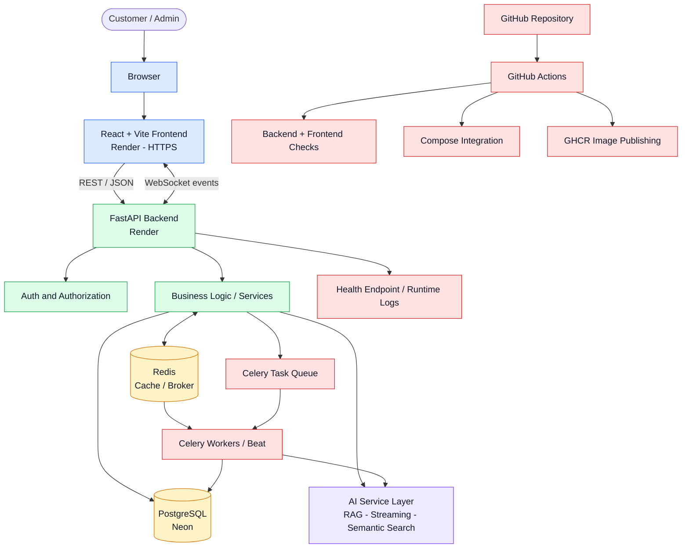
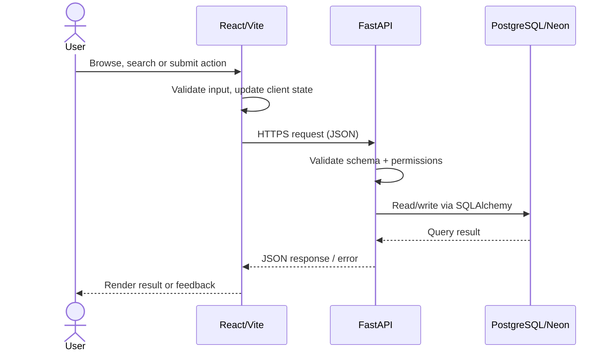
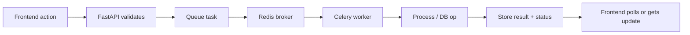
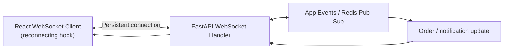
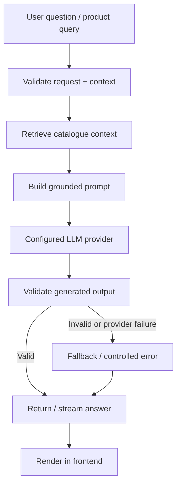
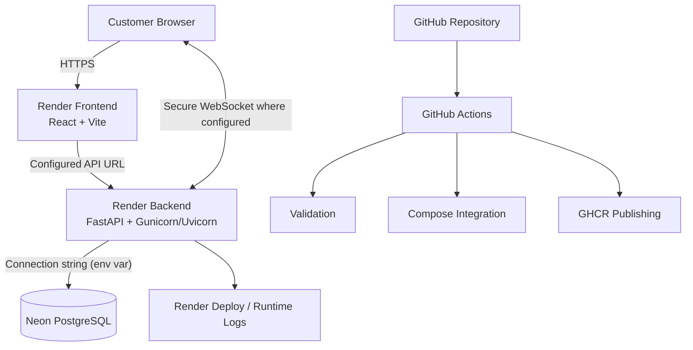
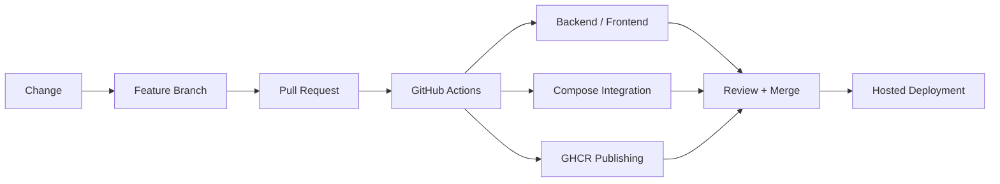
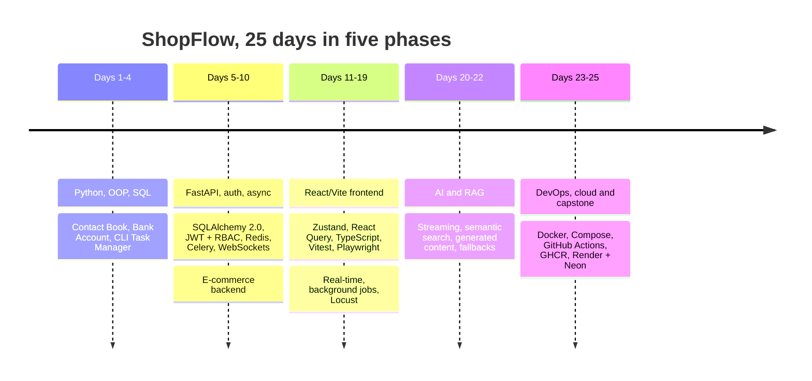

<!-- ============================================================
     ShopFlow README — copy & paste straight into GitHub
     Uses only GitHub-safe HTML + hosted badge/banner services
     ============================================================ -->

<p align="center">
  
</p>

<p align="center">
  <a href="https://github.com/abhinandanCS05/Coastal7_Learning_Internship">
    
  </a>
</p>

<p align="center">
  <b>Internship Engineering Portfolio · Coastal Seven Technologies Private Limited</b><br/>
  <sub>Knowledge Factory Internship Program 2026 · Batch 7 · 15 Sep – 16 Oct 2026</sub>
     Shop Flow Application : https://zeta-bwda.onrender.com
</p>

<p align="center">
  <a href="https://zeta-0pew.onrender.com"></a>
  <a href="https://zetaa.onrender.com"></a>
  <a href="https://zetaa.onrender.com/docs"></a>
  <a href="https://github.com/abhinandanCS05/Coastal7_Learning_Internship"></a>
</p>

<p align="center">
  
  
  
  
  
  
  
  
  
  
  
</p>

---

## 🧭 Navigate

<p align="center">
  <a href="#-at-a-glance">At a Glance</a> ·
  <a href="#-project-overview">Overview</a> ·
  <a href="#-live-environments">Live Links</a> ·
  <a href="#-features">Features</a> ·
  <a href="#-tech-stack">Tech Stack</a> ·
  <a href="#-architecture">Architecture</a> ·
  <a href="#-workflows">Workflows</a> ·
  <a href="#-ai--rag">AI &amp; RAG</a> ·
  <a href="#-repository-structure">Structure</a> ·
  <a href="#-run-locally">Run Locally</a> ·
  <a href="#-testing--quality">Testing</a> ·
  <a href="#-performance">Performance</a> ·
  <a href="#-deployment">Deployment</a> ·
  <a href="#-cicd">CI/CD</a> ·
  <a href="#-engineering-journey">Journey</a> ·
  <a href="#-daily-checklist">Checklist</a> ·
  <a href="#-problems-solved">Problems Solved</a> ·
  <a href="#-security-notes">Security</a> ·
  <a href="#-learning-outcomes">Learnings</a> ·
  <a href="#-maintainer">Maintainer</a>
</p>

---

## 📊 At a Glance

<table align="center">
  <tr align="center">
    <td><h1>25</h1><sub>engineering days</sub></td>
    <td><h1>120</h1><sub>products seeded</sub></td>
    <td><h1>6 · 17</h1><sub>categories · subcategories</sub></td>
    <td><h1>167</h1><sub>Playwright E2E tests passed</sub></td>
    <td><h1>21/21</h1><sub>Vitest passing (Day 16)</sub></td>
    <td><h1>100</h1><sub>peak concurrent users (Locust)</sub></td>
    <td><h1>100</h1><sub>Lighthouse score recorded (Day 19)</sub></td>
  </tr>
</table>

<p align="center"><sub>Figures come from the daily assessment tracker. Load-test numbers are workload-specific observations, not capacity guarantees.</sub></p>

---

## 🚀 Project Overview


**ShopFlow** is an AI-enhanced e-commerce application built during the Coastal Seven *Knowledge Factory* internship. Instead of a pile of disconnected mini-projects, the work was **extended incrementally into one system**, so each new phase integrated with the last:

> 🐍 Python & OOP → 🧪 FastAPI & SQL → 🔐 Auth & RBAC → ⚙️ Async, Redis & Celery → ⚛️ React/Vite frontend → 🔌 WebSockets → 🤖 AI/RAG → 🐳 Docker & CI/CD → ☁️ Managed deployment

The public deployment runs as **separate frontend and backend services on Render**, with **PostgreSQL on Neon**. The repository also ships Dockerfiles, a Docker Compose integration environment and GitHub Actions workflows for validation and container-image publishing.

<br clear="right"/>

### 🎯 Objectives

- Build a maintainable REST API and integrate it with a responsive web client.
- Implement relational persistence, authentication, authorization and database lifecycle management.
- Support background tasks and real-time status updates.
- Integrate AI assistance, retrieval-grounded answers, semantic discovery and generated product content.
- Add automated testing, containerized integration, CI/CD and load testing.
- Deploy with a cost-conscious managed-hosting architecture and document the decisions.

---

## 🌍 Live Environments

| | Resource | Link | Purpose |
|---|---|---|---|
| 🖥️ | Frontend | [zeta-0pew.onrender.com](https://zeta-0pew.onrender.com) | React/Vite user interface |
| ⚡ | Backend | [zetaa.onrender.com](https://zetaa.onrender.com) | FastAPI API service |
| 📘 | Interactive API docs | [Swagger UI](https://zetaa.onrender.com/docs) | Explore routes and schemas |
| 📦 | Repository | [Coastal7_Learning_Internship](https://github.com/abhinandanCS05/Coastal7_Learning_Internship) | Source code and engineering history |
| 🔀 | DevOps pull request | [PR #1](https://github.com/abhinandanCS05/Coastal7_Learning_Internship/pull/1) | Container and environment hardening |
| ✅ | GitHub Actions run | [Workflow run](https://github.com/abhinandanCS05/Coastal7_Learning_Internship/actions/runs/38534460711) | Validation, Compose integration, image publishing |

> 💤 **Heads-up:** free-tier Render services can take a moment to wake on the first request.

**Deployment model:** Render hosts the public frontend and backend; Neon hosts PostgreSQL. Redis/Celery and the full service topology live in the repository's Compose/integration configuration. Which services are active in a given environment depends on that environment's configuration.

---

## ✨ Features

<table>
<tr>
<td width="50%" valign="top">

### 🛍️ E-commerce experience
- Catalogue browsing and product detail views
- Search, filter, sort, category/subcategory discovery
- Customer authentication and protected views
- Cart and checkout workflows
- Order history and order-status experiences
- Admin product and inventory workflows

### 🧱 Backend and data
- FastAPI REST endpoints with request/response validation
- Pydantic schemas + SQLAlchemy 2.x data access
- PostgreSQL with environment-based configuration
- JWT auth and role-based access control
- Alembic migrations and structured error handling
- Health endpoint and Swagger documentation

</td>
<td width="50%" valign="top">

### ⚙️ Background jobs and real-time
- Redis caching (cache-aside, TTL, invalidation) and rate limiting
- Celery workers, retries, task state, Celery Beat scheduling
- WebSocket order updates and notifications
- PDF invoice generation and bulk product processing

### 🤖 AI-enhanced capabilities
- Streaming AI responses
- Retrieval-augmented product assistant
- Semantic product search
- AI-generated product descriptions and copy
- Provider fallback and output validation
- Response caching and per-user rate limits
- Bounded tool-calling / agent patterns

### 🚢 Engineering and delivery
- Docker multi-stage builds and Compose environment
- GitHub Actions validation and GHCR publishing
- Locust load testing, Gunicorn + Uvicorn workers
- Render deployment and runtime-log inspection

</td>
</tr>
</table>

---

## 🧰 Tech Stack

| Area | Technology | Role |
|---|---|---|
| 🖥️ Frontend | React, Vite, TypeScript | UI, client-side routing, typed contracts |
| 🎨 Styling | Tailwind CSS, Shadcn/ui patterns, Lucide icons | Responsive, reusable components |
| 🧠 Client state | Zustand | Cart and UI state |
| 🔄 Server state | TanStack Query | Query caching, mutations, pagination |
| 📝 Forms | React Hook Form, Zod | Form state and schema validation |
| ⚡ Backend | Python, FastAPI, Pydantic | API routes, validation, services |
| 🗄️ Database | PostgreSQL on Neon | Managed relational storage |
| 🧬 ORM / migrations | SQLAlchemy 2.x, Alembic | Data access and schema evolution |
| 🚀 Cache / broker | Redis | Caching and task/message coordination |
| 🛠️ Background jobs | Celery, Celery Beat, Flower | Workers, scheduling, monitoring |
| 🔌 Real-time | WebSockets | Order updates and notifications |
| 🤖 AI | Groq / Gemini / Mistral provider patterns, RAG, semantic retrieval | Assistance and generated content |
| 🧪 Testing | Pytest, Vitest, React Testing Library, Playwright | Backend and frontend validation |
| 📈 Load testing | Locust | Concurrency and latency observation |
| 🐳 Containers | Docker, Docker Compose | Reproducible packaging and integration |
| 🔁 CI/CD | GitHub Actions, GHCR | Automated checks and image publishing |
| ☁️ Hosting | Render, Neon | Public services and managed PostgreSQL |

> Exact dependency versions live in the repository's manifests and lockfiles. This table focuses on technologies and responsibilities rather than asserting version numbers.

---

## 🏗️ Architecture



### 🧱 Layer responsibilities

| Layer | Responsibility |
|---|---|
| 🎨 Presentation | React/Vite pages, reusable components, forms, product browsing, customer/admin flows, AI assistant UI |
| ⚡ API | FastAPI endpoints, validation, authorization, business rules, AI integrations |
| 🗄️ Persistence | PostgreSQL data, SQLAlchemy sessions/connection handling, Alembic migrations |
| ⚙️ Background processing | Redis/Celery dispatch, worker execution, retries, status handling |
| 🔌 Real-time | WebSocket connections and event delivery |
| 🤖 AI service layer | Context retrieval, prompt assembly, provider calls, streaming, response validation |
| 🛰️ Operations | Deployment logs, health checks, CI/CD, performance tests |

---

## 🔄 Workflows

### 1️⃣ Standard API request



### 2️⃣ Authentication and protected operations

1. 🔑 The user submits credentials through the frontend.
2. ✅ The backend validates the request, hashes/verifies the password and issues **JWT access/refresh tokens**.
3. 🎟️ Authenticated requests carry the token.
4. 🛡️ FastAPI dependencies and **role-based access control** protect restricted routes.
5. 📨 The API returns the resource or a structured authorization error.
6. 🧭 Frontend route guards mirror auth state in the UI, but **server-side authorization stays authoritative**.

### 3️⃣ Background task lifecycle



Used for longer-running work such as **PDF invoice generation, bulk product processing and reports**, so the request can acknowledge submission without making the browser wait.

### 4️⃣ Real-time workflow



WebSockets power live order-status updates and notifications; a reusable TypeScript hook handles connection states and reconnection. REST remains the standard path for ordinary request/response work.

---

## 🤖 AI &amp; RAG


The AI phase integrated **Groq, Gemini and Mistral** provider patterns behind a dedicated AI service layer, with dedicated routes for AI queries, streaming, semantic search, description generation and usage tracking.

<br clear="right"/>

### 🔍 Query-time RAG flow



### 🗺️ AI feature map

| Feature | Purpose |
|---|---|
| 🛒 Product assistant | Answers product questions using application context |
| 📚 RAG | Grounds responses in retrieved catalogue information |
| 🔎 Semantic search | Finds products by meaning, not just exact keywords |
| ✍️ AI copywriter | Generates product descriptions and catalogue copy |
| 🌊 Streaming | Delivers responses incrementally |
| 🛟 Provider fallback | Handles provider failures and unsuitable output gracefully |
| 🗃️ Caching + rate control | Reduces repeat work; per-user limits control volume |
| 🧰 Tool calling | Lets the model request **bounded** application operations through controlled backend logic |
| 📊 Usage visibility | Tracks AI usage and status through dedicated endpoints |

> 🔒 **Reliability rules:** incomplete outputs are rejected, and invalid generations are never cached.
>
> 📐 **Design boundary:** RAG here is the retrieval-and-generation pattern. Exact embedding model, vector-store configuration, chunking and index lifecycle should be read from the repository's implementation rather than inferred from this overview.

---

## 🗂️ Repository Structure

```text
Coastal7_Learning_Internship/
├── .github/
│   └── workflows/
│       └── day23-ci.yml          # validation · Compose integration · GHCR publish
├── backend/
│   ├── Dockerfile                # multi-stage build
│   ├── requirements.txt
│   └── app/
│       ├── main.py
│       ├── config.py
│       └── routes · schemas · services · auth · Redis/Celery · WebSockets · AI/RAG
├── frontend/
│   ├── Dockerfile                # multi-stage Node/Vite build → Nginx runtime
│   ├── package.json
│   ├── vite.config.ts
│   └── src/
│       ├── components/
│       ├── pages/
│       ├── hooks/
│       ├── services/
│       ├── store/
│       └── types/
├── docs/
├── compose.yaml                  # API · PostgreSQL · Redis · Celery worker · Beat · frontend
├── .env.example
├── .gitignore
├── RUN_BACKEND.ps1
├── RUN_FRONTEND.ps1
├── README.md
└── LICENSE
```

> The structure is a logical overview. Consult the source tree for exact current file paths.

---

## 💻 Run Locally

**Prerequisites:** Python compatible with `backend/requirements.txt` · Node.js compatible with `frontend/package.json` · Git · PostgreSQL + Redis for the full local stack · Docker Desktop (Compose) for the container workflow.

<details open>
<summary><b>1️⃣ Clone</b></summary>

```bash
git clone https://github.com/abhinandanCS05/Coastal7_Learning_Internship.git
cd Coastal7_Learning_Internship
git checkout day22-ai-application
```

The deployment branch may advance after this README is published; use the intended branch or commit for reproducible results.
</details>

<details>
<summary><b>2️⃣ Configure environment</b></summary>

```powershell
Copy-Item .env.example .env
```

Edit `.env` with local values. Do not share or commit it.
</details>

<details>
<summary><b>3️⃣ Start the backend</b></summary>

```powershell
cd backend
python -m venv .venv
.\.venv\Scripts\Activate.ps1
pip install -r requirements.txt
```

Start the API with the entry point documented by the backend package (confirm the ASGI module path in the source). The intended local port is `8000`, with Swagger UI at:

```text
http://127.0.0.1:8000/docs
```
</details>

<details>
<summary><b>4️⃣ Start the frontend</b></summary>

```powershell
cd frontend
npm ci
npm run dev
```

Vite prints the local URL. Make sure `VITE_API_URL` and `VITE_WS_URL` point to your local backend.
</details>

<details>
<summary><b>5️⃣ Docker Compose integration</b></summary>

```powershell
docker compose config
docker compose up --build
docker compose ps
docker compose logs -f
```

Compose brings together the **API, PostgreSQL, Redis, Celery worker, Celery Beat and frontend**, with dependencies, health checks, networking and named volumes. A working Docker Engine and Compose plugin are required.
</details>

---

## 🧪 Testing &amp; Quality

```powershell
# Frontend
cd frontend
npm ci
npm run typecheck
npm test
npm run build
```

```powershell
# Backend (activate venv + install requirements first)
pytest
```

### 📋 Recorded validation (from the tracker)

| Check | Recorded result |
|---|---|
| TypeScript check | ✅ Passed (Day 16) |
| Vitest | ✅ 21 / 21 passed (Day 16) |
| Production build | ✅ Passed (Day 16) |
| Playwright E2E | ✅ **167 tests passed** |
| Lighthouse | 💯 Score recorded as 100 (Day 19) |
| Post-merge GitHub Actions | ✅ 3 / 3 jobs successful |

---

## 📈 Performance

### 🐝 Locust load testing

<table>
<tr>
<td width="50%" valign="top">

**Baseline run**

| Metric | Observation |
|---|---|
| Users | ~50 |
| Duration | ~2 min |
| Requests | ~871 |
| Failures | **0** |
| Mean latency | ~4.48 s |
| Median latency | ~4.8 s |
| Max latency | ~9.38 s |
| Throughput | ~7.45 req/s |

</td>
<td width="50%" valign="top">

**Later run**

| Metric | Observation |
|---|---|
| Peak users | up to 100 |
| Duration | ~8 min |
| Request errors | **0** reported |

> ⚠️ These are observations from the tested workload and environment, not a guarantee for every traffic pattern.

</td>
</tr>
</table>

### 🐘 PostgreSQL connection management

- Hosted on **Neon**; accessed via SQLAlchemy sessions.
- Recorded non-SQLite pool settings: `pool_size=5`, `max_overflow=5`, `pool_timeout=30s`, `pool_recycle=300s`.
- Request-scoped sessions close through a `finally` cleanup block.
- A **QueuePool timeout** seen under concurrent load was investigated by looking at concurrency, query duration, engine settings and connection-holding paths, rather than assuming a missing `close()`.
- Pool size must be tuned together with worker count, concurrency, query duration and database limits.

### 🏭 Production serving

The FastAPI service runs under **Gunicorn with Uvicorn workers** on Render. Worker count and pool settings should be tuned together to avoid creating more concurrent database demand than the database can support.

---

## ☁️ Deployment



### 🤔 Why Render + Neon?

| Decision | Rationale |
|---|---|
| Render for frontend and backend | Existing working deployment retained; no duplicate cloud deployment needed |
| Neon for PostgreSQL | Managed relational persistence |
| React/Vite, not Next.js | Matches the actual frontend; a Vercel/Next.js migration wasn't required |
| Render-managed HTTPS, not Nginx/Certbot | TLS handled by the platform for the current deployment |
| Docker Compose for integration | Repeatable multi-service validation |
| GitHub Actions for CI | Automated validation and container publishing |
| AWS studied, not provisioned | AWS payment verification blocked EC2 setup; the live app stayed on Render/Neon |

EC2, IAM, S3, CloudWatch, load balancing and Auto Scaling were **studied as concepts** and are **not** represented as live resources. Render's managed logs and health checks are also not equivalent to a full Prometheus/Sentry/CloudWatch stack.

---

## 🔁 CI/CD



### 🧾 Delivery evidence

| Evidence | Reference |
|---|---|
| Repository | [Coastal7_Learning_Internship](https://github.com/abhinandanCS05/Coastal7_Learning_Internship) |
| Pull request | [PR #1](https://github.com/abhinandanCS05/Coastal7_Learning_Internship/pull/1) |
| Actions run | [Run 38534460711](https://github.com/abhinandanCS05/Coastal7_Learning_Internship/actions/runs/38534460711) |
| DevOps commit | `12de3dc` — `feat(devops): harden containers and environment configuration` |
| Merged branch | `day22-ai-application` |
| Remote merge commit | `dffea545cb071ca61eea407e2ab745f1433c1be4` |

The post-merge workflow showed **three successful jobs**: backend/frontend validation, Docker Compose integration, and container-image publishing to GHCR. (The GHCR publish job being *skipped* on pull requests was correctly distinguished from a *failed* job.)

---

## 🧗 Engineering Journey

The 25-day programme moved through five connected phases:



<details>
<summary><b>📖 Phase-by-phase narrative</b> (click to expand)</summary>

**1. Python, API design and data fundamentals.** Control flow, functions, data structures, file handling, exceptions and OOP, with a Contact Book and a Bank Account. SQL/PostgreSQL with psycopg2 powered an OOP CLI Task Manager (Task/TaskManager abstractions, CRUD, relational queries, JSON export, logging, unit tests). Git branching was introduced alongside.

**2. FastAPI, validation, persistence and security.** REST APIs with FastAPI and Pydantic; SQLAlchemy 2.0 with async engine/session patterns and Alembic migrations; password hashing, JWT access/refresh tokens, OAuth2PasswordBearer, dependency-based current-user handling, RBAC, CORS and environment-based config. A dedicated Task Management API added project/task CRUD, status workflows, filtering and pagination.

**3. Async processing, caching and integrations.** Async I/O, Redis cache-aside with TTL and invalidation, rate limiting, Celery retries and task-state retrieval, Celery Beat, Flower, file upload validation and image processing, WebSocket connection management, plus pytest, pytest-asyncio, linting, typing and pre-commit practice.

**4. E-commerce backend and frontend.** Auth, products, cart, orders and real-time updates consolidated into ShopFlow. The frontend grew from React fundamentals into Tailwind, Shadcn/ui, form validation, category/subcategory filtering, search and sorting, protected customer/admin views and FastAPI integration, against a catalogue of **120 products, 6 categories and 17 subcategories**. Zustand, TanStack Query, pagination/infinite scroll, TypeScript, Vitest, Playwright and React Hook Form + Zod followed.

**5. Full-stack integration, real-time and search.** Aligned frontend/backend auth contracts, CORS, endpoints and WebSocket event formats; added a reusable TypeScript WebSocket hook, UI-triggered Celery tasks with progress/results, PostgreSQL full-text and typo-tolerant search, PDF invoices and bulk processing.

**6. AI, RAG and agentic features.** Provider integration (Groq, Gemini, Mistral), an AI service layer, streaming, RAG, semantic search, AI descriptions, content moderation, response caching, per-user rate limiting, provider fallback, usage visibility, response validation and controlled tool execution.

</details>

---

## ✅ Daily Checklist

Day 1 to Day 25, with the key outcome of each day.

| Day | Date | Outcome | Done |
|---|---|---|---|
| Day 1 | 17 Sep | Python fundamentals and FastAPI; Student REST API, HTTP methods, Pydantic validation | ☑️ |
| Day 2 | 18 Sep | Control flow, functions, collections, JSON/CSV, exceptions; Contact Book | ☑️ |
| Day 3 | 19 Sep | OOP: classes, inheritance, polymorphism, abstraction; Bank Account | ☑️ |
| Day 4 | 21 Sep | PostgreSQL/psycopg2 and OOP CLI Task Manager with CRUD, JSON export, logging, tests | ☑️ |
| Day 5 | 22 Sep | FastAPI, Pydantic V2, SQLAlchemy 2.0 async, PostgreSQL, Alembic, user/product CRUD | ☑️ |
| Day 6 | 23 Sep | Password hashing, JWT access/refresh, OAuth2 flow, RBAC, protected APIs, CORS | ☑️ |
| Day 7 | 24 Sep | Task Management API: projects/tasks, status workflow, filtering, pagination, migrations | ☑️ |
| Day 8 | 25 Sep | Async, Redis cache/rate limiting, Celery retries/results, Beat, Flower | ☑️ |
| Day 9 | 26 Sep | File uploads, image validation/resizing, WebSockets, notifications, code quality | ☑️ |
| Day 10 | 28 Sep | E-commerce backend: auth, products, cart/order workflows, integrations | ☑️ |
| Day 11 | 29 Sep | React fundamentals, hooks, component design, routing | ☑️ |
| Day 12 | 30 Sep | Tailwind/Shadcn UI, forms, validation, dynamic forms, image preview, accessibility | ☑️ |
| Day 13 | 01 Oct | ShopFlow React/Vite frontend integrated with FastAPI; discovery, auth, admin | ☑️ |
| Day 14 | 03 Oct | Zustand, React Query, pagination/infinite scroll, custom hooks, caching | ☑️ |
| Day 15 | 05 Oct | TypeScript contracts, typed hooks/components, Vitest, Playwright | ☑️ |
| Day 16 | 06 Oct | Cart/checkout, order history, admin; TypeScript, 21/21 Vitest, build, Playwright | ☑️ |
| Day 17 | 07 Oct | Env config, WebSocket integration, live order updates, reconnection | ☑️ |
| Day 18 | 08 Oct | Celery from UI, task progress, PDF invoices, bulk processing, PostgreSQL search | ☑️ |
| Day 19 | 09 Oct | Full-stack integration, performance polish, Lighthouse 100, Locust/pool investigation | ☑️ |
| Day 20 | 10 Oct | AI providers, streaming chat, RAG pipeline, AI service layer, fallback validation | ☑️ |
| Day 21 | 12 Oct | AI descriptions, moderation, semantic search, caching, rate limits, tool execution | ☑️ |
| Day 22 | 13 Oct | AI-enhanced routes, streaming, semantic search, usage visibility, Render deployment | ☑️ |
| Day 23 | 14 Oct | Docker multi-stage, Compose, secret hardening, GitHub Actions, GHCR, protected PR merge | ☑️ |
| Day 24 | 15 Oct | Render/Neon deployment approach, HTTPS, health/log review, AWS fundamentals | ☑️ *alternative approach* |
| Day 25 | 16 Oct | Capstone: Locust tests, pool investigation, Gunicorn/Uvicorn, Docker/CI/CD, docs, demo and review | ☑️ |

---

## 🛠️ Problems Solved

<table>
<tr>
<td width="50%" valign="top">

**🔌 Contract mismatches**
Inspected the real FastAPI and WebSocket contracts, then aligned client routes, auth keys and event formats.

**📄 Pagination shape change**
Updated the API response shape and audited every frontend consumer instead of relying on the old array-only contract.

**🐞 Search HTTP 500**
Traced to a changed service-function signature; the route now passes the database session.

</td>
<td width="50%" valign="top">

**🤖 AI provider variability**
Added fallback logic, output validation, and rejection of incomplete results before caching or returning them.

**🐘 QueuePool timeouts**
Investigated concurrency, query duration, engine settings and connection-holding paths under Locust load.

**🔁 CI "skipped" vs "failed"**
Read job behaviour against workflow triggers: the GHCR publish skip on PRs wasn't a failure, and the post-merge run passed.

</td>
</tr>
</table>

### 🧠 Engineering judgement

- Extended **one** application incrementally to keep integration continuity across backend, frontend, AI and DevOps.
- Validated changes with automated and end-to-end tests, and traced errors to the exact route, schema, service or client contract.
- Kept secrets and endpoints in environment configuration, separate from source.
- Kept container-based validation and CI/CD as reproducible controls even though production uses managed hosting.
- Weighed operational concerns (pool exhaustion, AI latency, fallbacks, logs, health endpoints) alongside feature work.

---

## 🛡️ Security Notes

- 🚫 Never commit real `.env` values, database URLs, JWT secrets or provider API keys.
- 🧱 Do not expose PostgreSQL or Redis directly to the public internet.
- 👀 Keep `VITE_` variables secret-free; they ship in client bundles.
- 🔒 Use HTTPS for public API traffic and secure WebSockets where configured.
- 🔑 Apply least-privilege permissions to cloud identities and deployment credentials.
- 📈 Interpret load-test metrics in context: workload, latency, concurrency, duration and error count all matter.
- 🧹 Keep logs and error messages free of credentials and sensitive user data.

---

## 🎓 Learning Outcomes

<table>
<tr>
<td valign="top" width="33%">

**🧱 Backend**
- Python and OOP
- FastAPI and Pydantic
- SQL, PostgreSQL, SQLAlchemy, Alembic
- Auth, RBAC, env-based config

</td>
<td valign="top" width="33%">

**🖥️ Frontend and real-time**
- React/Vite, TypeScript
- Client vs server state, forms
- WebSockets and live workflows
- Vitest and Playwright

</td>
<td valign="top" width="33%">

**🚢 Systems and delivery**
- Redis, Celery, async jobs
- AI streaming, RAG, validation
- Docker, Compose, GitHub Actions
- Locust, pool tuning, managed cloud

</td>
</tr>
</table>

---

## 👨‍💻 Maintainer


### Venkata Abhinandan Kancharla

Artificial Intelligence &amp; Machine Learning Engineer<br/>
🏢 Coastal Seven Technologies Private Limited<br/>
🚀 Knowledge Factory Internship Program 2026 · Batch 7<br/>
🛠️ Role: AI intern — ShopFlow (backend, frontend, AI, DevOps)

<a href="https://github.com/abhinandan6123"></a><br/>
<a href="https://abhikancharla.vercel.app"></a>

<br clear="right"/>

---

<p align="center">
  <i>Built with purpose. Validated through iteration. Delivered with an engineering mindset.</i>
</p>

<p align="center">
  
</p>
